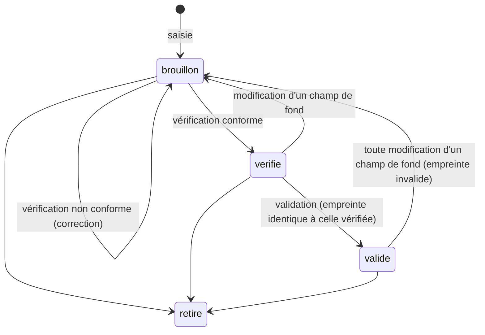

# Règle de saisie, vérification et validation de la table de sécurité

> Version 1.0 — 2026-10-15
> S'applique à `data/securite.yaml` (spécification §3.2).
> Toute évolution de cette règle passe par une nouvelle version de ce document, commitée **avant** les entrées qui l'utilisent.

---

## 1. Objectif

La table de sécurité décide si l'outil peut proposer un dosage. Chaque valeur doit donc pouvoir être :

- **auditée** : on sait d'où elle vient (ouvrage, page, phrase exacte), qui l'a saisie et quand ;
- **vérifiée** : on peut la comparer au livre en quelques secondes, sans interprétation ;
- **validée** : une décision explicite la rend utilisable, et toute modification ultérieure annule cette validation.

---

## 2. Principes

| # | Principe |
|---|---|
| P1 | **Une entrée = une valeur.** Une ligne de la table ne porte qu'un seul fait (un plafond, un drapeau ou une contre-indication), pour une seule HE, une seule voie, une seule population. |
| P2 | **Citation obligatoire.** Toute entrée recopie la phrase ou la ligne de tableau exacte de la source, dans sa langue d'origine. |
| P3 | **Aucune valeur générée.** Aucune valeur ne provient d'un LLM, de la mémoire, d'un site non listé ou du « bon sens ». |
| P4 | **Fail closed.** Sans plafond validé pour une HE, une voie et une population données, l'outil ne propose pas de dosage. |
| P5 | **Asymétrie de prudence.** Une entrée qui *autorise* (plafond) n'est utilisée qu'une fois validée. Une entrée qui *restreint* (drapeau, contre-indication) s'applique dès sa saisie, même en brouillon. |
| P6 | **Aucune suppression.** Une entrée erronée est retirée (statut `retire` + motif), jamais effacée ; l'historique git complète la traçabilité. |

---

## 3. Sources autorisées

| Rang | Source | Rôle |
|---|---|---|
| Primaire | Tisserand R., Young R. — *Essential Oil Safety*, 2ᵉ éd., Churchill Livingstone, 2014 | Plafonds, drapeaux, contre-indications |
| Complémentaire | Monographies EMA/HMPC ; mises en garde ANSM / ANSES | Uniquement pour **restreindre** davantage |

- Une source complémentaire ne peut jamais relever un plafond ni lever une contre-indication de la source primaire.
- Ajouter une autre source impose une nouvelle version de cette règle.

---

## 4. Format d'une entrée

Fichier : `data/securite.yaml`, liste d'entrées. Les valeurs entre `< >` sont à saisir ; **ce document ne contient volontairement aucune valeur réelle**.

```yaml
- id: SEC-0001                       # identifiant unique, séquentiel, jamais réutilisé
  type: plafond                      # plafond | plafond_total | drapeau | interdit_profil
  he_id: lavande_vraie               # identifiant du référentiel data/huiles.yaml ; "*" pour une règle générale
  nom_latin: Lavandula angustifolia  # tel qu'écrit dans la source ; doit correspondre au référentiel
  chemotype: null                    # chémotype cité par la source, ou null si la source n'en cite pas
  voie: cutanee                      # diffusion | cutanee | bain | massage | inhalation (type plafond / plafond_total)
  population: adulte                 # moins_3 | de_3_a_6 | de_6_a_12 | de_12_a_18 | adulte | plus_65
  valeur: <nombre>                   # type plafond / plafond_total uniquement
  unite: "%"                         # unité telle qu'écrite dans la source
  base_pourcentage: null             # "p/p" ou "v/v" si la source le précise, sinon null
  drapeau: null                      # type drapeau : phototoxique | dermocaustique | neurotoxique |
                                     #   hormone_like | allergene | interaction_medicament
  profil: null                       # type interdit_profil : grossesse_allaitement | epilepsie | asthme |
                                     #   traitement | pathologie_hormonale | <tranche d'âge>
  detail: null                       # précision utile (ex. classe de médicament concernée)

  source:
    ouvrage: "Tisserand & Young, Essential Oil Safety, 2e éd., 2014"
    page: <n>
    localisation: "<monographie, section ou tableau>"   # ex. "Monographie Lavender, Safety summary"
    citation: "<texte exact recopié>"

  interpretation: null               # null si la valeur est recopiée telle quelle ;
                                     #   sinon numéro(s) de règle appliquée(s) (§5) + explication

  saisie:
    par: "<nom>"
    le: <AAAA-MM-JJ>
    methode: manuelle                # manuelle | assistee (voir R13)
  verification:
    par: null
    le: null
    resultat: null                   # conforme | non_conforme
    commentaire: null
    empreinte: null                  # calculée par l'outil au moment de la vérification (§7)
  validation:
    par: null
    le: null
    empreinte: null                  # calculée par l'outil au moment de la validation (§7)

  statut: brouillon                  # brouillon | verifie | valide | retire
  motif_retrait: null
```

### Champs obligatoires par type

| Type | Champs spécifiques obligatoires |
|---|---|
| `plafond` | `voie`, `population`, `valeur`, `unite` |
| `plafond_total` | `he_id: "*"`, `voie`, `population`, `valeur`, `unite` |
| `drapeau` | `drapeau` (+ `detail` pour `interaction_medicament`) |
| `interdit_profil` | `profil` |

Pour tous les types : `id`, `he_id`, `nom_latin` (sauf `*`), `source.*`, `saisie.*`, `statut`.

---

## 5. Règles d'interprétation

Quand la source ne donne pas exactement la donnée attendue, on applique **uniquement** les règles ci-dessous, et on cite leur numéro dans `interpretation`. Un cas non couvert ⇒ pas d'entrée, et la question est ajoutée en §10.

| # | Règle |
|---|---|
| R1 | **Recopie.** La valeur numérique est recopiée telle quelle, sans arrondi ni conversion. |
| R2 | **Fourchette.** Si la source donne une fourchette, on retient la **borne basse**. |
| R3 | **Plusieurs valeurs.** Si la source donne plusieurs valeurs applicables à la même voie et population, on retient la **plus restrictive**. |
| R4 | **Espèce et chémotype.** Une valeur ne s'applique qu'à l'espèce (nom latin exact) et au chémotype cités. Pas d'extension à une espèce voisine ni à un autre chémotype. Si la source ne précise pas de chémotype, `chemotype: null`. |
| R5 | **Pas de recalcul.** Si la source calcule le plafond d'une HE à partir d'un constituant, on recopie le plafond de l'HE énoncé par la source ; on ne refait jamais le calcul à partir d'une composition. |
| R6 | **Pas d'extrapolation entre voies.** Une valeur cutanée ne vaut pas pour le bain ou le massage, sauf si la source le dit explicitement (citation à l'appui). |
| R7 | **Pas d'extrapolation entre populations.** Une valeur adulte ne vaut pas pour un enfant ni pour une personne âgée. Population sans valeur ⇒ pas de dosage. |
| R8 | **« Pas de limite » n'est pas « illimité ».** Si la source n'indique aucune limite pour une HE, on ne crée pas d'entrée `plafond` : c'est le `plafond_total` de la voie et de la population (règle générale) qui s'applique. Sans règle générale validée ⇒ pas de dosage. |
| R9 | **Contre-indications.** Toute mention du type « à éviter », « ne pas utiliser », « contre-indiqué » pour un profil donne une entrée `interdit_profil`. Une mention « avec prudence » donne aussi une entrée `interdit_profil` (prudence ⇒ refus de dosage automatisé), avec la nuance dans `detail`. |
| R10 | **Interactions.** Toute interaction médicamenteuse citée donne une entrée `drapeau: interaction_medicament` avec la classe de médicament dans `detail`. |
| R11 | **Sources complémentaires.** Une entrée issue d'une source complémentaire n'est créée que si elle est plus restrictive que la source primaire ; l'outil applique toujours la plus restrictive de toutes les entrées valides. |
| R12 | **Unités.** L'unité est recopiée telle qu'écrite. Si elle n'est pas un pourcentage dans le produit final, l'entrée reste en `brouillon` et la question est ajoutée en §10. |
| R13 | **Saisie assistée.** Un outil (OCR, LLM) peut transcrire une page **fournie par toi** (photo ou texte de la page). L'entrée est alors marquée `methode: assistee`, reste en `brouillon`, et la vérification se fait obligatoirement contre le livre papier ou le PDF original, pas contre la transcription. |

---

## 6. Cycle de vie et effet dans l'outil



| Statut | `plafond` / `plafond_total` (autorise) | `drapeau` / `interdit_profil` (restreint) |
|---|---|---|
| `brouillon` | ignoré | **appliqué**, signalé « non validé » |
| `verifie` | ignoré | **appliqué**, signalé « non validé » |
| `valide` + empreinte correcte | **appliqué** | **appliqué** |
| `valide` + empreinte incorrecte | ignoré + alerte | **appliqué** + alerte |
| `retire` | ignoré | ignoré |

- **Vérification** : relecture de l'entrée contre la source (checklist §8), idéalement par une autre personne (aromathérapeute), sinon par toi lors d'une **session distincte** de la saisie (date différente).
- **Validation** : décision de mise en service, par toi. Elle n'est possible que si `verification.resultat: conforme`.

---

## 7. Empreinte de validation

Pour qu'une valeur validée ne puisse pas être modifiée sans que cela se voie :

- au moment de la **vérification**, l'outil calcule une empreinte SHA-256 des **champs de fond** : `type`, `he_id`, `nom_latin`, `chemotype`, `voie`, `population`, `valeur`, `unite`, `base_pourcentage`, `drapeau`, `profil`, `detail`, `source.*`, `interpretation` ;
- au moment de la **validation**, il recalcule l'empreinte et refuse de valider si elle diffère de celle de la vérification : on valide exactement ce qui a été vérifié ;
- à chaque chargement, l'outil recalcule l'empreinte ; si elle diffère, l'entrée est traitée comme non validée (§6) et une alerte est affichée ;
- une entrée `verifie` dont l'empreinte ne correspond plus est traitée comme `brouillon` ;
- les champs de suivi (`saisie`, `verification`, `validation`, `statut`, `motif_retrait`) ne font pas partie de l'empreinte.

Commandes prévues (phase 1) :
- `agent-he securite verifier SEC-0001 --conforme | --non-conforme "<commentaire>"` : renseigne `verification.*`, calcule l'empreinte, passe le statut à `verifie` (ou le laisse en `brouillon`) ;
- `agent-he securite valider SEC-0001` : contrôle les préconditions et l'empreinte, renseigne `validation.*`, passe le statut à `valide`.

---

## 8. Checklist de vérification (par entrée)

À cocher en ayant le livre ouvert à la page indiquée :

- [ ] La page et la localisation indiquées contiennent bien la citation.
- [ ] La citation est recopiée **mot pour mot**.
- [ ] Le nom latin (et le chémotype s'il y en a un) correspond à la source **et** au `he_id` du référentiel.
- [ ] La valeur et l'unité correspondent à la citation, sans arrondi.
- [ ] La voie et la population sont celles dont parle la citation (pas d'extrapolation, R6–R7).
- [ ] Si `interpretation` est renseignée : la règle citée existe et a été appliquée correctement.
- [ ] Aucune autre mention de la même page ne contredit ou ne restreint davantage cette valeur (sinon, créer l'entrée correspondante).

Résultat dans `verification` : `conforme` si toutes les cases sont cochées, sinon `non_conforme` avec le point en échec dans `commentaire`.

---

## 9. Contrôles automatiques et rapport d'audit

### Contrôles au chargement (bloquants en CI)

1. Schéma : champs obligatoires selon le type (§4), valeurs dans les énumérations, `valeur > 0`, pourcentage ≤ 100.
2. `id` uniques ; `he_id` présent dans le référentiel ; `nom_latin` cohérent avec le référentiel.
3. `statut: verifie` ⇒ `verification.*` renseigné ; `statut: valide` ⇒ en plus `validation.*` renseigné et les deux empreintes identiques et correctes.
4. `verification.le` postérieure ou égale à `saisie.le` ; `validation.le` postérieure ou égale à `verification.le`.
5. `methode: assistee` ⇒ vérification renseignée avant tout passage en `verifie`.
6. `statut: retire` ⇒ `motif_retrait` renseigné.

### Rapport d'audit

Commande prévue (phase 1) : `agent-he securite rapport`, qui produit `docs/audit/securite-<date>.md` :

| id | HE | nom latin | type | voie | population | valeur | page | statut | citation |
|---|---|---|---|---|---|---|---|---|---|

suivi de :
- **Couverture** : pour chaque HE du référentiel, les voies et populations sans plafond validé (donc sans dosage possible) ;
- **À traiter** : entrées en `brouillon` ou `verifie`, entrées à empreinte invalide, entrées `assistee` non vérifiées ;
- **Interprétations** : toutes les entrées dont `interpretation` n'est pas nulle, avec la règle appliquée.

Le rapport est imprimable pour une vérification page par page avec le livre.

---

## 10. Questions ouvertes

Cas rencontrés lors de la saisie et non couverts par les règles R1–R13. Chaque question est tranchée par une nouvelle version de ce document avant toute entrée concernée.

| # | Date | HE / page | Question | Décision | Version |
|---|---|---|---|---|---|
| — | — | — | — | — | — |
